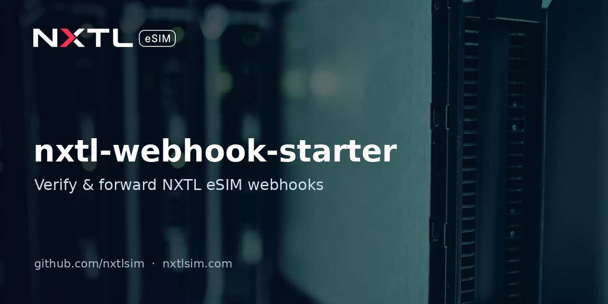

# nxtl-webhook-starter



A minimal, production-minded receiver for **NXTL eSIM webhooks**: verifies the HMAC-SHA256 signature on the raw body, rejects stale or tampered deliveries, de-duplicates by event id and forwards each event to Slack. Python (FastAPI) and a single-file Cloudflare Worker.

> **Status:** Built against the published API reference; not yet tested against the live API.
> Maintained by [NXTL eSIM](https://nxtlsim.com).

## Who it's for
Developers integrating the [NXTL B2B API](https://nxtlsim.com/nxtl-api-reference/) for travel platforms, company mobility or device fleets who want `balance.low`, `esim.provisioned` or `usage.recorded` events in Slack in minutes. API access is for approved [NXTL Business](https://nxtlsim.com/for-business/) accounts.

## How NXTL signs webhooks
Per the API reference, every delivery carries:

```
X-NXTL-Signature-V1: t=<unix_timestamp>,v1=<hmac_sha256_hex>
```

`v1` = HMAC-SHA256 of `{t}.{raw_json_body}` using your active webhook secret. Always verify the **raw** body before parsing JSON. This starter also rejects timestamps older than 300 s (configurable, our own replay-protection choice).

Events documented (15): `esim.provisioned`, `esim.provision_failed`, `esim.tier_changed`, `esim.suspended`, `esim.reactivated`, `esim.terminated`, `esim.exchanged`, `esim.usage_threshold`, `balance.topup`, `balance.low`, `balance.exhausted`, `usage.recorded`, `job.completed`, `job.failed`, `test.ping`. Envelope: `{ id, event, timestamp, data }`.

## Quick start (FastAPI)
```bash
pip install -r requirements.txt
export NXTL_WEBHOOK_SECRET=your_webhook_secret
export SLACK_WEBHOOK_URL=https://hooks.slack.com/services/...   # optional
uvicorn app:app --host 0.0.0.0 --port 8000
```
Register `https://your-host/webhooks/nxtl` as your webhook URL, then send a `test.ping` from the partner portal.

Run the tests: `pytest -q`

## Quick start (Cloudflare Worker)
```bash
npm create cloudflare@latest nxtl-hooks   # choose "Hello World" worker, replace src with worker.js
npx wrangler secret put NXTL_WEBHOOK_SECRET
npx wrangler secret put SLACK_WEBHOOK_URL
npx wrangler deploy
```

## Files
| File | Purpose |
|---|---|
| `app.py` | FastAPI receiver + `verify_nxtl_signature()` |
| `worker.js` | Cloudflare Worker version (Web Crypto) |
| `tests/test_signature.py` | Valid, wrong secret, tampered body, stale, malformed, endpoint |

The de-duplication set is in memory; use Redis or your database in production.

## Links
- NXTL eSIM: https://nxtlsim.com
- NXTL for Business: https://nxtlsim.com/for-business/
- API reference: https://nxtlsim.com/nxtl-api-reference/
- Low-balance polling instead of webhooks: [nxtl-balance-alerts](https://github.com/nxtlsim/nxtl-balance-alerts)

## License
MIT © NXTL eSIM. This repository is maintained by NXTL eSIM.
